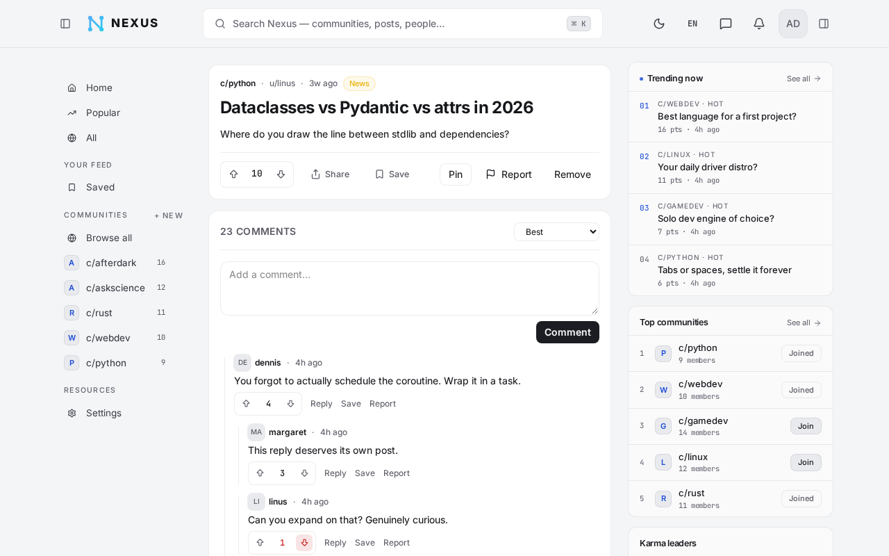

# Nexus

> A community-driven forum / Q&A platform.

Nexus lets people create and join communities, share text, link, image, and poll posts, and discuss them in nested comment threads. Voting drives both content ranking (hot/top feeds) and user karma, while follows, direct messages, and notifications keep members connected. Communities are self-governed: creators appoint moderators who manage rules and flairs, review held posts and reports, ban users, and pin posts.

The project is split into two independent applications: a Django REST Framework backend exposing a versioned JSON API (`/api/v1/`) secured with JWT, and a React single-page app that consumes it. Everything runs on PostgreSQL — including full-text search — and ships with Docker images and a production compose stack.

## Features

**Content & Communities**
- Communities with membership roles (admin / moderator / member), icons, rules, and NSFW flags
- Four post kinds: text, link, image (with upload validation), and poll
- Post flairs (per-community, managed by mods), sticky/pinned posts, NSFW tagging
- Member flairs: mods define per-community badges shown beside author names and assign them; admins can let members pick their own (cleared on ban/leave, logged in the mod log)
- Removal reasons: mods keep per-community templates; removing someone's post/comment records the reason in the mod log (title only is shown) and notifies the author; admins can require a reason
- Modmail: users (including banned ones, max 5 new threads per community per day) message the mod team; a shared moderator inbox with assignment, archive and internal notes that users never see; unread counts and realtime wake-ups
- Nested comment trees with author avatars, inline replies, `@username` mention autocomplete and mentions rendered as profile links
- Markdown editor with server-rendered, sanitized preview; links keep only absolute `http(s)`/`mailto`, site-root (`/…`) and `#…` targets (anything else renders as plain text) and always carry `rel="nofollow noopener noreferrer ugc"`
- Post drafts — debounced autosave to localStorage with restore/discard

**Voting & Feeds**
- Up/down voting on posts and comments with optimistic UI and rollback
- User karma (post + comment) kept in sync via signals, plus a `recalculate_karma` management command
- Home feed (joined communities), Following feed, Popular/All feeds for anonymous visitors
- `new` / `top` / `hot` sorting with a time range (past hour … all time), post-kind filters, NSFW filtering, pagination

**Social**
- Follow system with followers/following lists
- Direct messages: conversations, read receipts (✓ / ✓✓), unread counters; new messages and receipts show up live
- Notifications (comment, reply, mention, follow, DM, mod action) with bell dropdown and inbox page, delivered live over a WebSocket with polling as the fallback
- Navbar badges for unread notifications and messages come from one call, `GET /api/v1/users/me/unread-counts/` (`{notifications, messages}`), refetched on realtime events; polling (30s without the socket, 5 min with it) pauses in hidden tabs
- User blocking — cuts DMs and follows both ways, suppresses notifications
- Public user profiles with karma badges, post/comment tabs, profile editing, and an optional country shown with its flag

**Discovery**
- Full-text search (PostgreSQL `SearchVector` + GIN, ranked with `SearchRank`) across posts, communities, and people
- Trending widgets: most active communities and top posts of the last 24h (cached)
- Karma leaderboard (top users, cached)
- Server-rendered Open Graph pages so shared links unfurl in Discord/WhatsApp/Twitter

**Moderation**
- Generic reporting (posts, comments, users) with a 24h per-target rate limit
- Mod panel: approval queue, report queue (resolve/dismiss), rules, flairs, community bans, moderator assignment, pin/remove actions
- Community settings editable by admins: icon, display name, description, NSFW flag, and "hold new posts for approval"
- Approvals are pinned to the version the moderator saw: a post edited while it waits in the queue must be reviewed again, and in approval-required communities an edit to an approved post's title, body, link, or image (or dropping its NSFW flag) sends it back to the queue
- AutoMod: a per-community keyword list that holds matching posts for approval. Matching folds case, accents, invisible characters, and punctuation (`b.a.d` matches `bad`) and also checks rendered markdown text, link targets (percent-decoded, punycode hosts decoded), and keywords added on later edits
- Mod action audit log — every pin, ban, approval, and report decision is recorded

**Accounts & Privacy**
- JWT auth (SimpleJWT) with refresh rotation and blacklist, register/login/logout
- The refresh token lives in an `HttpOnly`, `SameSite=Strict` cookie scoped to `/api/v1/auth/`; the access token is kept in memory only, so scripts on the page can't read either from storage
- Password reset and email verification flows (console backend in dev, SMTP via env)
- Account settings: theme, interface language, NSFW preference, password change
- Data export: download everything you wrote or chose (profile, posts, comments, sent messages, votes, saves, follows, blocks, memberships) as JSON
- Account deletion: personal data is erased while content stays attributed to a `deleted-<id>` placeholder; communities you created are handed to their highest-ranked active member, and every outstanding token is revoked
- Atom feeds: `GET /api/v1/communities/<slug>/feed.atom`, `/api/v1/users/<name>/posts.atom` and `/api/v1/posts/<id>/comments.atom` (`?sort=new|top`, `?t=` window, `?page=`, 50 entries per page with a `rel="next"` link). Feeds never include NSFW communities or posts, held, removed or deleted content, or copies of posts that are gone; spoiler posts and bodies containing `>!..!<` appear as title and link only. Output is the same for every viewer, cached for 60 s and served with ETag / Last-Modified (304 on a conditional GET) under the anonymous throttle. Community, post and profile pages (SPA and Open Graph) advertise them with `<link rel="alternate" type="application/atom+xml">`
- Custom feeds: build up to 20 feeds of up to 50 communities each (`/api/v1/users/me/feeds/`, `/api/v1/users/<name>/feeds/<slug>/` and `.../posts/`, SPA at `/feeds` and `/u/<name>/feeds/<slug>`). Only the owner can edit; public feeds are read-only for everybody, and a private feed answers 404 to everyone else so its existence is not revealed. Posts use the same pipeline as every other feed (sort, time window, `answered`, NSFW preference, hidden posts, approval and removal rules); a community where the viewer is banned yields no posts, and deleting a community drops it from feeds. Feeds are part of the data export and erased with the account
- Feed filters: keep a community out of Popular, All and trending (`POST/DELETE /communities/<slug>/feed-exclusion/`, list at `GET /users/me/feed-exclusions/`, at most 200 per user). Your Home feed (joined communities), Following feed, community pages and notification levels are unaffected. Managed from the community page and Settings; part of the data export
- Hide posts: signed-in users can hide a post (`POST/DELETE /posts/<id>/hide/`, list at `GET /users/me/hidden/`, capped at 5000 with the oldest falling off). Hidden posts disappear from that user's Home, Following, Popular/All, community, search and trending lists, but not from profiles or direct links. The SPA shows an inline undo and a Hidden page; hidden ids are part of the data export and are erased with the account
- Crossposts: members share a post into another community they belong to (`POST /posts/<id>/crosspost/`). Chains are flattened to the original; the copy goes through the target's approval queue and AutoMod, inherits NSFW and spoiler flags (NSFW cannot be cleared, and viewers without NSFW access cannot crosspost NSFW posts), and a user can crosspost a given original to a community once. Content is locked (only the title is editable), votes and comments stay separate, and when the original is deleted, removed or held its copies show a `[deleted]` placeholder. Polls cannot be crossposted
- Spoilers: authors (and moderators, via `POST/DELETE /posts/<id>/spoiler/`) can mark a post as a spoiler: feeds show only its title, and the body or image stays hidden behind a click, like NSFW. Inline `>!hidden text!<` in posts and comments renders as a click- or keyboard-revealed span (only `class="spoiler"` survives sanitizing; put text before the marker, since `>` at a line start is a quote). Link previews (Open Graph) of spoiler posts carry a generic title and no image; edits, AutoMod and approval re-queueing ignore the flag
- Question & answer mode: text posts can be asked as questions (communities can switch this off with `qa_enabled`). The asker or a moderator accepts one answer, which is pinned first and earns its author +15 karma (granted once per accepted answer, reversed if the acceptance is removed). Askers can reserve a 50-500 karma bounty (steps of 50, never below zero balance): it goes to the accepted answer, or is refunded after 7 days or when the question is removed (`manage.py expire_bounties`, run by the worker's maintenance loop). Every karma movement is a `KarmaAdjustment`, so `recalculate_karma` stays consistent. Feeds accept `?answered=false|true`, and the community page has an "Unanswered" toggle

**Interface**
- Light, dark, and system themes; Inter and JetBrains Mono are self-hosted, so the app loads no third-party resources
- One-click light/dark and EN/TR toggles in the navbar, available to signed-out visitors too
- Interface language picker (EN/TR via i18next) with full Turkish coverage, `<html lang>` and per-page titles; an ESLint rule blocks hard-coded English in JSX
- Responsive from 360 px: mobile navigation drawer below 960 px, tap-to-reveal for NSFW images
- Sessions survive refresh hiccups (429/network) and stay in sync across tabs; stale-chunk errors reload once
- Uploaded images are automatically downscaled (avatars 512px, post images 1920px)
- Rate throttling per scope (auth, write, vote), pagination, and permission classes throughout

## Tech Stack

| Layer    | Technology |
|----------|------------|
| Backend  | Python 3.12, Django 6.1, Django REST Framework, SimpleJWT, markdown-it-py + nh3 |
| Database | PostgreSQL 16 (full-text search, GIN indexes) |
| Frontend | React 19 (Vite, TypeScript), React Router, Redux Toolkit, TailwindCSS 4, Lucide icons |
| Testing  | pytest + pytest-cov (backend), Vitest + React Testing Library (frontend) |
| Tooling  | ruff (lint + format), ESLint |
| Deploy   | Docker (gunicorn + WhiteNoise, uvicorn + Django Channels for WebSockets, nginx SPA + API/WebSocket proxy), Redis, docker-compose |

## Project Structure

```
community-forum/
├── .github/workflows/ci.yml    CI: backend lint + tests on PostgreSQL, frontend lint, build and tests
├── backend/                    Django + DRF API
│   ├── config/                 settings (base / dev / prod), root URLs, pagination, WSGI (API) / ASGI (realtime)
│   ├── apps/
│   │   ├── users/              accounts, JWT auth and refresh cookie, profiles, data export, account deletion
│   │   ├── communities/        communities, memberships and roles, rules, flairs, bans
│   │   ├── posts/              text/link/image/poll posts, feeds and sorting, approvals, AutoMod, edit history
│   │   ├── comments/           nested comment threads, mentions, edit history
│   │   ├── votes/              up/down votes and karma
│   │   ├── polls/              poll options and votes
│   │   ├── messaging/          direct-message conversations and read receipts
│   │   ├── notifications/      notification inbox and unread counts
│   │   ├── social/             follows and blocks
│   │   ├── saves/              saved posts and comments
│   │   ├── moderation/         reports and the mod action log
│   │   ├── search/             full-text search and trending widgets
│   │   ├── seo/                Open Graph pages for link previews
│   │   ├── realtime/           WebSocket event stream: one-time tickets, consumer, event publishing
│   │   └── common/             markdown rendering, image handling, throttling, health check
│   ├── Dockerfile              gunicorn image; entrypoint.sh runs migrations on start
│   └── requirements*.in/.txt   runtime and dev dependencies (.in = direct pins, .txt = hashed lock)
├── frontend/                   React SPA
│   ├── src/
│   │   ├── api/                axios client (token refresh, cross-tab lock) and endpoint wrappers
│   │   ├── app/                Redux store and typed hooks
│   │   ├── features/           Redux slices and types per domain (auth, posts, comments, …)
│   │   ├── components/         UI kit (ui/), layout (navbar, sidebars, drawer) and domain components
│   │   ├── pages/              route-level screens
│   │   ├── router/             routes, protected routes, error page
│   │   ├── i18n/               English and Turkish strings
│   │   ├── lib/                shared helpers (theme, time, paths, paging, polling, realtime connection, drafts)
│   │   └── styles/             design tokens (dark and light) and self-hosted font faces
│   ├── public/                 logo, fonts, theme-init script
│   ├── nginx.conf, nginx/      SPA serving, API/media proxy, security headers
│   └── Dockerfile              build with Node, serve with nginx
├── docs/screenshots/           README images
├── docker-compose.yml          local PostgreSQL (and optional Redis for realtime) for development
└── docker-compose.prod.yml     production stack: PostgreSQL, Redis, backend, realtime, task worker, nginx frontend
```

## Installation

Requirements: Python 3.12+, Node 26+, Docker (or a local PostgreSQL 16).

```bash
# Database
docker compose up -d          # starts PostgreSQL on :5432 (DB_PORT=5433 docker compose up -d if 5432 is taken)

# Backend — http://localhost:8000
cd backend
python -m venv venv && source venv/bin/activate
pip install --require-hashes -r requirements-dev.txt   # runtime deps + dev tools; the Docker image installs requirements.txt only
cp .env.example .env          # fill in values (match DB_PORT if you changed it)
python manage.py migrate
python manage.py seed              # optional: demo users/communities/posts (login: any user / password123)
python manage.py runserver

# Frontend — http://localhost:5173
cd frontend
npm install
cp .env.example .env          # VITE_API_URL
npm run dev
```

### Updating Python dependencies

`requirements.in` and `requirements-dev.in` list the direct dependencies; the `.txt` files are lock files generated by [pip-tools](https://pip-tools.readthedocs.io/) with every package (transitive ones too) pinned and hashed. Don't edit the `.txt` files by hand: change the `.in` file, then regenerate both locks from `backend/` with Python 3.12 (the command is also in each lock file's header):

```bash
pip-compile --allow-unsafe --generate-hashes --strip-extras --output-file=requirements.txt requirements.in
pip-compile --allow-unsafe --generate-hashes --strip-extras --output-file=requirements-dev.txt requirements-dev.in
```
### Background email worker

Account emails (registration, email changes, verification resend and password reset) are queued in PostgreSQL after transaction commit. The production Compose stack starts `worker` from the same backend image after the API is healthy; only the API container runs migrations. The queue does not use Redis.

For local development, run a second backend terminal with the same database and email environment:

```bash
python manage.py db_worker --no-reload
```

Tests use `config.settings.test` with an immediate backend; queue integration tests exercise PostgreSQL and the real worker. Both existing and unknown password-reset accounts enqueue one task and return the same response even if enqueue fails. Unknown accounts use an inert ID of 0. The worker performs the same recipient lookup, state HMAC, token generation and message construction for these dummy jobs, but sends no mail. This reduces timing differences without claiming constant-time behavior: database row loading, input sizes, scheduling and real SMTP delivery still differ; shared queue latency can expose those differences indirectly. Task arguments contain only a user ID and a keyed state digest. Tokens and links are generated inside the worker; stale jobs are discarded after relevant account changes. SMTP failures are logged without addresses or SMTP details; users can request another email (there is no automatic retry).

`EMAIL_TIMEOUT` defaults to 30 seconds per SMTP socket operation; `EMAIL_USE_TLS` defaults to `True`. Both are shared by the API and worker. The worker finishes its current task on SIGTERM, with a 60-second Compose shutdown grace period; keep SMTP timeouts below that window. The project `db_worker` command writes a PID readiness marker after initialization and a database probe, immediately before polling. Compose `--wait` requires this marker and a live worker PID. The marker is cleared before startup maintenance and on normal/error exits; the restart policy handles process exits. This is a startup/liveness check, not a heartbeat: monitor queue age and failures separately to detect a stuck worker. Console email output contains live links; use SMTP for real delivery.

The production worker entrypoint runs maintenance at startup and hourly (completed jobs: 14 days, failed jobs: 30 days), without another scheduler service. Maintenance failures at startup or during the hourly loop are logged and retried at the next hourly interval without stopping the worker. Retention preserves pending/running jobs. Recovery marks default-backend `RUNNING` jobs older than 60 minutes as `FAILED`; it never retries them because a killed job might already have delivered mail. Worker completion writes lock and recheck the result row, so a late success or failure cannot overwrite recovery; completion signals report the preserved result. Set the manual recovery age above the longest legitimate task duration. Local `db_worker` does not start this maintenance loop. Manual commands (add `--dry-run` to preview retention deletions):

```bash
python manage.py recover_stale_tasks --older-than-minutes 60
python manage.py prune_db_task_results --min-age-days 14 --failed-min-age-days 30
# In the production stack:
docker compose -f docker-compose.prod.yml exec worker python manage.py prune_db_task_results --min-age-days 14 --failed-min-age-days 30
```

### Realtime updates

Notifications, unread badges, new direct messages and read receipts arrive over a WebSocket served by a separate ASGI process (`config/asgi.py`, Django Channels on uvicorn); the API itself stays on gunicorn. In the production stack the `realtime` service runs from the backend image and nginx forwards `/ws/` to it, so the SPA connects on its own origin.

- **Signals only**: events carry a type and ids (`{"type": "message.created", "conversation_id": 12}`); the SPA then refetches through the REST API, so permissions, blocks and NSFW rules are enforced in one place and no content travels over the socket.
- **Authentication**: the SPA asks `POST /api/v1/realtime/ticket/` (JWT, throttled by `THROTTLE_REALTIME_TICKET`, default `30/min`) for a one-time ticket valid for 30 seconds, opens `/ws/v1/stream/` and sends `{"type": "auth", "ticket": "..."}` as the first frame. Neither the JWT nor the ticket ever appears in a URL. The ticket is bound to the session it was issued in: one bought before a password change or a logout is refused. A socket also lives no longer than the access token that bought its ticket: it closes with code 4002 when that token expires, and the SPA reconnects with a fresh token.
- **Revocation**: password changes, password resets, account deletion and logout close the user's open sockets. Logout is user-wide: it ends the sockets on every device, and the user's other signed-in tabs reconnect with a fresh ticket. The server also re-checks the account on its own timer (about once a minute) and before forwarding every event, so a socket that misses the revocation event, or a client that never pings, is closed anyway.
- **Limits**: nginx allows 30 sockets per client address and 1000 in total on `/ws/` (429 beyond that; behind another proxy, configure the realip module first). The realtime service accepts at most `REALTIME_MAX_PENDING_SOCKETS` (default 256) sockets per process that have not authenticated yet, and the whole handshake must finish within 5 seconds. Each user may hold `REALTIME_MAX_SOCKETS_PER_USER` (default 10) sockets across all processes; further ones close with code 4029. These slots live in Redis (`REALTIME_SLOT_REDIS_URL`, default `REDIS_URL`), where they are taken, refreshed and released with atomic owner checks; backend tests run them against a real Redis when `REALTIME_TEST_REDIS_URL` is set.
- **Origins**: sockets are accepted only from `FRONTEND_URL` and `CSRF_TRUSTED_ORIGINS`; anything else, or a missing `Origin`, is refused.
- **Fallback**: realtime needs `REDIS_URL` (the channel layer uses its own database, `REALTIME_REDIS_DB`, default `2`). Without it the ticket endpoint answers 503 and the SPA keeps polling (badges every 30s, an open conversation every 4s). With the socket up those polls slow down to a safety net, and the SPA resyncs after every reconnect, because Redis may evict events under memory pressure.

For local development, start Redis and run uvicorn next to `runserver`, with the same `REDIS_URL` in both (it also moves the dev cache to Redis, so both processes see the tickets):

```bash
docker compose up -d redis            # from the repo root; listens on 127.0.0.1:6379
# in backend/.env: REDIS_URL=redis://localhost:6379/1
DJANGO_SETTINGS_MODULE=config.settings.dev uvicorn config.asgi:application --reload --port 8001 --ws websockets-sansio
```

The Vite dev server proxies `/ws` to port 8001. Set `VITE_REALTIME_URL` only when the SPA and the realtime service are on different origins.

## Testing

The backend has 800+ pytest tests and the frontend 340+ Vitest tests. Backend tests run against a real PostgreSQL (full-text search and GIN indexes don't exist in SQLite), so start the database first; pytest-django creates and drops its own test database.

```bash
# Backend
cd backend
docker compose up -d                  # from the repo root, if PostgreSQL isn't running yet
pytest                                # full suite
pytest apps/posts                     # one app
pytest --cov --cov-report=term-missing   # app code only; CI fails below 90%
ruff check . && ruff format --check .

# Frontend
cd frontend
npm test                              # single run (npm run test:watch to watch)
npm run lint
npm run build                         # includes the TypeScript type check
```

What the suites cover:

- **API behavior** — endpoints are exercised through DRF's test client: permissions, validation, pagination, throttling, and error responses
- **Moderation rules** — approval snapshots and re-approval on edit, AutoMod normalization, ban enforcement, moderator hierarchy, held-post visibility
- **Race conditions** — concurrent votes (on real threads), interleaved edits and moderator actions, and ban races must not double-count or overwrite each other
- **Query budgets** — feeds, threads, inboxes, and mod queues assert an upper bound on SQL queries, so N+1 regressions fail the build
- **Security** — markdown sanitization and link filtering, token revocation, refresh-cookie handling, account deletion and data export
- **Frontend** — components and pages rendered with React Testing Library and driven with user-event; API client token refresh, cross-tab session sync, drafts, polling, and i18n

[GitHub Actions](.github/workflows/ci.yml) runs all of the above on every push to `main` and on every pull request, with a PostgreSQL 16 service container.

## CI and security

- **[CI](.github/workflows/ci.yml)**: backend and frontend lint, type check, build and tests.
- **[Security](.github/workflows/security.yml)**: Semgrep and zizmor (SAST), gitleaks, Trivy (dependencies, Dockerfiles, images, SBOM), dependency review on pull requests, Django deploy checks and a ZAP baseline that fails on the rules in [.github/zap/rules.tsv](.github/zap/rules.tsv) (known, deferred alerts are listed there as report-only). Semgrep results are also uploaded to GitHub code scanning (Security tab).
- **[Scorecard](.github/workflows/scorecard.yml)**: OpenSSF Scorecard runs weekly and on pushes to `main`, and uploads its results to code scanning.
- **[SECURITY.md](SECURITY.md)**: how to report a vulnerability privately.

The scanner images are pinned by digest and updated by hand; the steps are at the top of [security.yml](.github/workflows/security.yml). Maintainer notes live in a local `.docs/` directory (in Turkish, not committed).

## Releases

Pushing a `v*` tag triggers the release workflow; it can also be run manually from `main` (manual runs use a unique `run-<id>-<attempt>` image tag). Only commits already on `main` are released. It builds `ghcr.io/<owner>/nexus-backend` and `ghcr.io/<owner>/nexus-frontend` without build cache, blocks publication on fixable HIGH/CRITICAL Trivy findings, and publishes provenance, CycloneDX SBOM attestations and keyless signatures. It does not deploy. The job summary lists each digest and exact verification commands:

```bash
# Replace owner/repository, digest and tag with the release values.
gh attestation verify oci://ghcr.io/<owner>/nexus-backend@sha256:<digest> --repo <owner>/<repository> --cert-identity https://github.com/<owner>/<repository>/.github/workflows/release.yml@refs/tags/<tag>
cosign verify --certificate-identity https://github.com/<owner>/<repository>/.github/workflows/release.yml@refs/tags/<tag> --certificate-oidc-issuer https://token.actions.githubusercontent.com ghcr.io/<owner>/nexus-backend@sha256:<digest>
```

## Screenshots


*Home feed — sorting, time range, post-kind filters, inline polls and trending widgets.*


*Post page in the light theme — share/save/report, pin/remove actions for moderators, and nested comments with avatars.*


*Moderator tools — a post held by AutoMod, the report queue, and AutoMod keywords.*

## License

MIT — see [LICENSE](./LICENSE).
