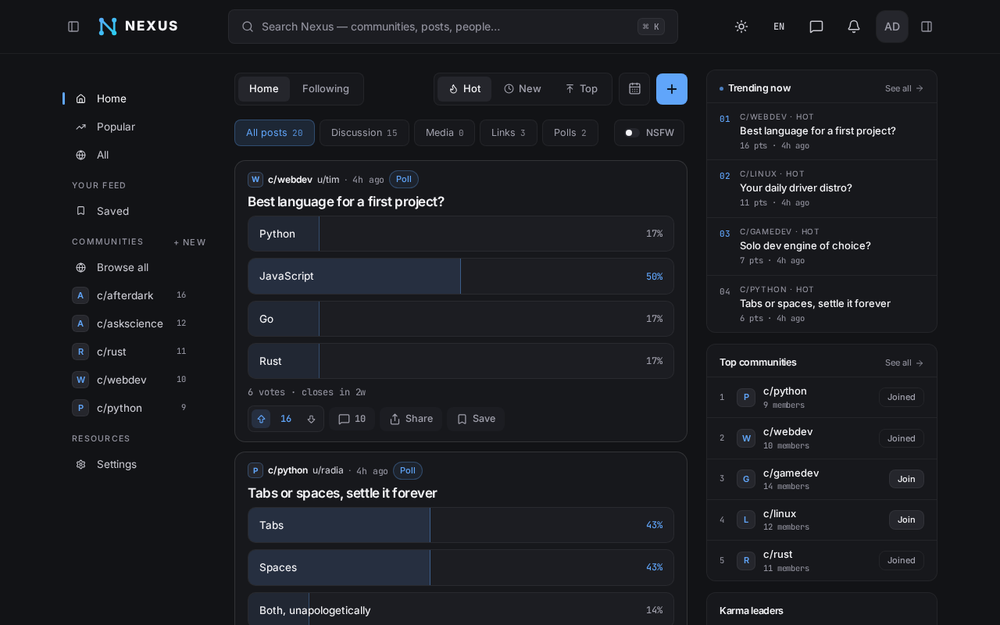
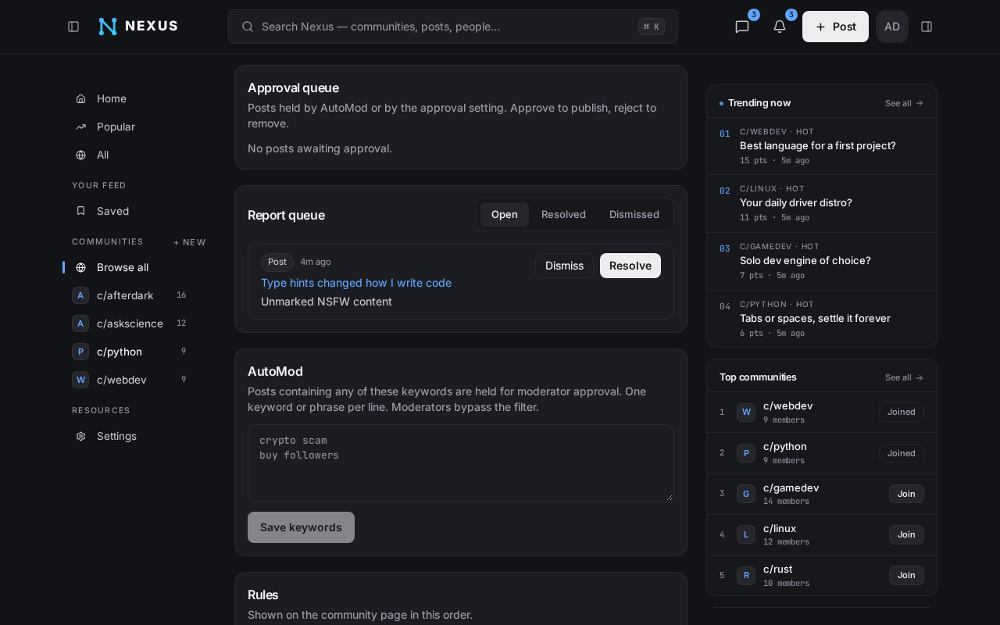

# Nexus

Nexus is a community forum. People join communities, share posts and talk about them in threaded comments, and each community is run by its own moderators. It is built as a Django REST API and a React web app on PostgreSQL.

## Features

**Posts & discussion**
- Share text, link, image and poll posts, with a preview and saved drafts
- Comment in threads, reply to others and mention people by name
- Vote on posts and comments; votes earn karma and decide what rises in the feeds
- Ask a question, accept the best answer and offer karma as a bounty
- Mark a post, or part of a text, as a spoiler
- Crosspost to another community
- Hide posts, keep communities out of your feeds and build your own custom feeds
- Search posts, communities and people, and see what is trending
- Follow communities, profiles and comment threads in any feed reader (RSS/Atom)

**Communities & moderation**
- Create communities with their own rules, post flairs, pinned posts and adult-content settings
- Give members a flair shown next to their name
- Review held posts and reports, ban users, hold posts that contain chosen keywords and keep a log of every moderator action
- Tell authors why their post or comment was removed
- Modmail: members write to the moderator team, who share one inbox

**Messaging & notifications**
- Private messages with read receipts
- Notifications for replies, mentions, follows, messages and moderator actions
- Live updates for new notifications and messages
- Push notifications, and an app you can install on your phone or computer

**Accounts & privacy**
- Sign up, verify your email and reset your password
- Two-step verification with an authenticator app and recovery codes
- Follow or block people; profiles show posts, comments and karma
- Download your data or delete your account

**App & interface**
- Light and dark themes, in English and Turkish
- Works on phones and desktops
- Uploaded images can optionally be kept in cloud storage

## Tech Stack

| Layer      | Technology                                                     |
|------------|----------------------------------------------------------------|
| Backend    | Python 3.12, Django 6.1, Django REST Framework, Django Channels |
| Database   | PostgreSQL 16                                                  |
| Frontend   | React 19, TypeScript, Vite, Redux Toolkit, Tailwind CSS 4      |
| Testing    | pytest, Vitest, React Testing Library                          |
| Deployment | Docker Compose, nginx, Redis                                   |

## Project Structure

```
community-forum/
├── backend/                  Django API
├── frontend/                 React web app
├── docker-compose.yml        PostgreSQL and Redis for local development
├── docker-compose.prod.yml   full production stack
├── .github/                  CI and security workflows
└── docs/screenshots/         images used in this README
```

## Installation

Requirements: Python 3.12, Node 26 and Docker.

Start the database from the repository root:

```bash
docker compose up -d postgres
```

Run the backend at http://localhost:8000:

```bash
cd backend
python -m venv venv && source venv/bin/activate
pip install -r requirements-dev.txt
cp .env.example .env
python manage.py migrate
python manage.py seed        # optional demo data; demo users log in with password123
python manage.py runserver
```

Account emails (verification, password reset) are printed to the terminal by a worker. To see them, run `python manage.py db_worker --no-reload` in a second backend terminal.

Run the frontend at http://localhost:5173, in another terminal from the repository root:

```bash
cd frontend
npm install
cp .env.example .env
npm run dev
```

For production, copy `.env.prod.example` to `.env`, fill in the values and run `docker compose -f docker-compose.prod.yml up -d --build`.

## Testing

Backend (needs the database running):

```bash
cd backend
pytest
ruff check . && ruff format --check .
```

Frontend:

```bash
cd frontend
npm test
npm run lint
npm run build
```

## CI and security

[CI](.github/workflows/ci.yml) runs linting, tests and builds on every pull request and push to `main`.
[Security](.github/workflows/security.yml) adds code, secret, dependency and container scans and a ZAP baseline, and [Scorecard](.github/workflows/scorecard.yml) rates the repository weekly.
To report a vulnerability, see [SECURITY.md](SECURITY.md).

## Screenshots


*Home feed with sorting, post filters, an inline poll and trending communities.*


*Post page in the light theme, with moderator actions and nested comments.*


*Moderator tools: a held post, the report queue and the keyword list.*

## License

MIT. See [LICENSE](LICENSE).
